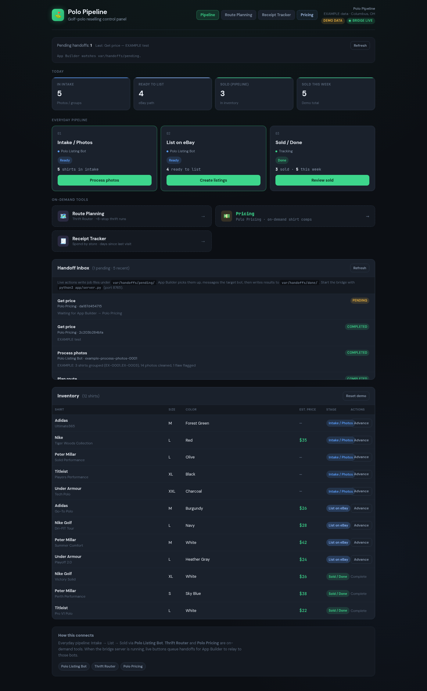
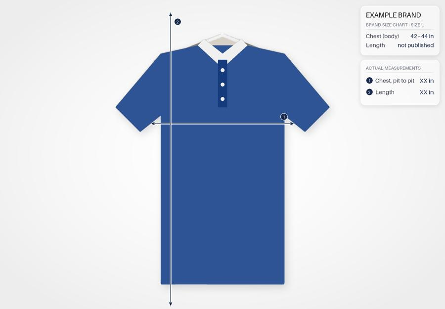

# Polo Pipeline

This is the little control panel I use for my golf-polo reselling side hustle: find thrift stores, buy shirts that'll
actually sell, photograph them, price them and get them listed on eBay. Full disclosure: AI coding agents wrote
basically all of this code. I described what I wanted, tested it on real thrift runs and kept asking for changes.
A few AI "bots" also do the heavy lifting behind it (route planning, pricing, listing drafts), and this app is how
I hand them work and see what came back.

Everything in the repo runs on **EXAMPLE data**: made-up stores in Columbus, OH, made-up receipts, fake SKUs and
generated placeholder photos. None of my real stores, routes, listings, sales or photos are in here.



## The pipeline

| Stage | What happens | Who does it |
|---|---|---|
| 1. Thrift run | Plan an ~8-stop loop that fits the time I have, with drive legs, arrive/leave times, store hours, and gas/food stops I can drag in. Stops I hit recently get flagged from my receipts. | **Thrift Router** bot (`plan_route`) + the Route Planning page |
| 2. Buy or pass | Snap the shirt and its tag in the store. Local OCR reads brand/size/fabric, I answer a few questions, and it says BUY or PASS with a max price to pay (aim: 3x return after fees and shipping). | **Polo Pricing** bot (`get_price`) + the Pricing page |
| 3. Receipts | Photo of the receipt, OCR pulls store/date/items/total. It rolls up spend, visits and days since last visit per store, plus my own 1–5 rating. | Receipt Tracker page (`app/receipt.py`) |
| 4. Intake + photos | Dump photos in a folder; the bot groups them by shirt (SKU sticker shot first), cuts the shirt out, kills the hanger and builds the listing photo set with measurement overlays. | **Polo Listing Bot** (`process_photos`) + `tools/photos/listing_photo.py` |
| 5. List | Draft title (80 chars max), item specifics, description, price ending in .67, photo order. Nothing goes live until I approve it. | **Polo Listing Bot** (`create_listings`) + `templates/listing_template.md` |
| 6. Inventory, SKUs, re-price | Inventory board on the home page (intake → list → sold). For stale listings, a re-price/relist plan with new titles, prices, minimum offers, spec fixes and a step-by-step relist checklist. | Inventory board + `tools/listings/release_plan.py` |

### How the bots fit in (handoffs)

The app never talks to eBay or to the bots directly. When I click a button it writes a job file:

```
var/handoffs/pending/<time>-<action>-<id>.json   ->  an agent ("App Builder") picks it up, messages the right bot
var/handoffs/done/<id>.json                      <-  the result comes back here and the UI shows it
```

Allowed actions are `plan_route`, `process_photos`, `create_listings` and `get_price`. What each bot needs and
returns is written down in `contracts/*.json`. To close a job by hand (or from your own agent):

```bash
python3 app/complete_handoff.py <job_id> --summary "Route ready: 8 stops" --result '{"stops": []}'
python3 app/complete_handoff.py <job_id> --failed --summary "Bot unavailable"
```

The bots themselves aren't in this repo; they're AI agents with instructions. The contracts are the useful part if
you want to wire up your own.

## Run it

Python 3.10+. The server is stdlib only; OCR needs two packages.

```bash
pip install -r requirements.txt
python3 app/server.py --demo        # --demo copies the EXAMPLE fixtures into ./var
# open http://127.0.0.1:8765
```

Pages: **Pipeline** (home, inventory, handoff inbox), **Route Planning**, **Receipt Tracker**, **Pricing**.
The map uses OpenStreetMap tiles, and the server proxies geocoding (Nominatim) and road routing (OSRM), so those
parts need internet. Leaflet and the fonts are self-hosted in `web/vendor/`.

Photo tool (optional, heavier):

```bash
pip install -r requirements-tools.txt
python3 tools/photos/listing_photo.py measure examples/photos/example_front.jpg out.jpg \
  --brand "Peter Millar" --size L --chart-chest "43 - 45 in" --chest "22 in" --length "29 in"
python3 tools/photos/listing_photo.py plain  in.jpg out.jpg --pad 200
python3 tools/photos/listing_photo.py gentle tag.jpg tag_out.jpg
python3 tools/photos/listing_photo.py label  out.jpg out.jpg "Front · Measurements"
```



Re-price plan:

```bash
python3 tools/listings/release_plan.py examples/release_plan.example.csv --name group1 --release 2026-11-01
# -> plan/group1_plan.csv, plan/group1_plan.md, plan/group1_checklist.txt
```

## Config (env vars)

Copy `.env.example` to `.env`, fill it in, then `set -a; . ./.env; set +a` before starting. Nothing needs an API key.

| Var | Default | What it does |
|---|---|---|
| `POLO_HOST` / `POLO_PORT` | `127.0.0.1` / `8765` | Where the server listens |
| `POLO_DATA_DIR` | `./var` | Jobs, uploads, receipts, ratings (gitignored) |
| `POLO_DEMO` | `0` | `1` = same as `--demo` |
| `POLO_HOME_LABEL` / `POLO_HOME_LAT` / `POLO_HOME_LNG` | none | Your usual start/end point. No default on purpose; without it you get the EXAMPLE start. |
| `POLO_PITSTOPS_FILE` | `config/pitstops.example.json` | Your gas/food stops (same JSON shape) |
| `POLO_NOMINATIM_UA` | generic | Nominatim wants an identifying User-Agent; put your app name + contact |
| `POLO_NOMINATIM_BASE` / `POLO_OSRM_BASE` | public servers | Point at your own if you run them |
| `POLO_URL` | `http://127.0.0.1:$POLO_PORT` | Used by `complete_handoff.py` |
| `POLO_FONT` | Pillow default | TTF for the photo overlays |
| `HANGER_TOL` / `HANGER_GRAY` | `12` / `1` | Hanger removal tuning in the photo tool |
| `POLO_FETCH_DIR` / `POLO_FETCH_UA` | `listing_photos` / Chrome UA | For `tools/listings/fetch_listing_photos.sh` |

## What's where

```
app/server.py            local bridge: static app, handoff queue, uploads, geocode/route/pit-stop proxies, receipts, ratings
app/vision.py            offline tag OCR + color guess for pricing (RapidOCR)
app/receipt.py           receipt OCR + parsing
app/complete_handoff.py  mark a job done/failed
web/index.html           the whole UI (one file)
contracts/               what each bot takes and returns
config/                  EXAMPLE pit stops
examples/                EXAMPLE handoffs, receipts, ratings, re-price CSV, generated placeholder photos
templates/               listing draft template
tools/photos/            listing photo builder
tools/listings/          re-price/relist plan builder, listing photo fetcher (your own listings only)
data/                    public brand sell-through snapshot (reference only)
```

## Notes

- Pricing math in the UI demo: expected sale × 0.83 − $5 shipping = net; max buy = net ÷ 3; list ≈ expected × 1.15.
  The real call comes back from the Polo Pricing bot with sold comps.
- The demo comps on the Pricing page are generated on the fly and labeled as sample data. Comp links are eBay
  sold-search links, not specific listings.
- Store chain names in `app/receipt.py` are only there so OCR can recognize a receipt header.
- It's a personal tool. It runs on localhost, has no auth, and shouldn't be exposed to the internet as-is.

MIT licensed (see `LICENSE`). Vendored Leaflet is BSD-2 and the fonts are OFL (see `web/vendor/README.md`).
